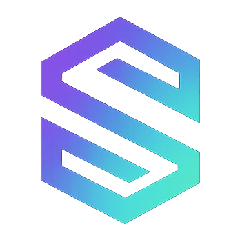
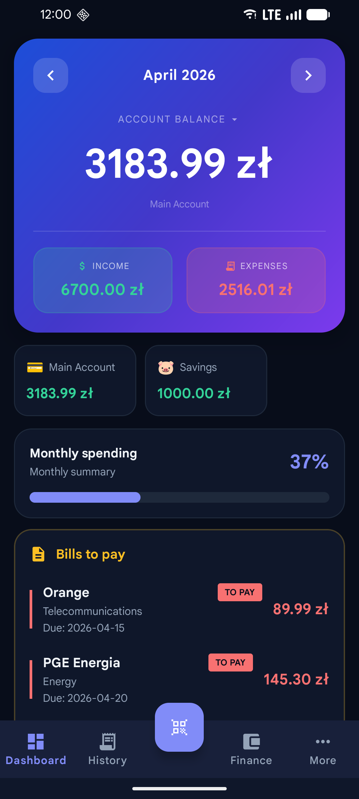
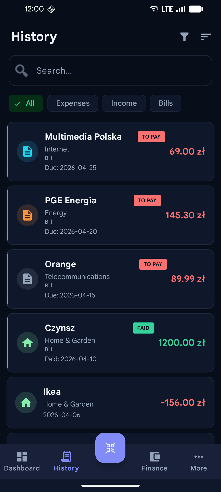
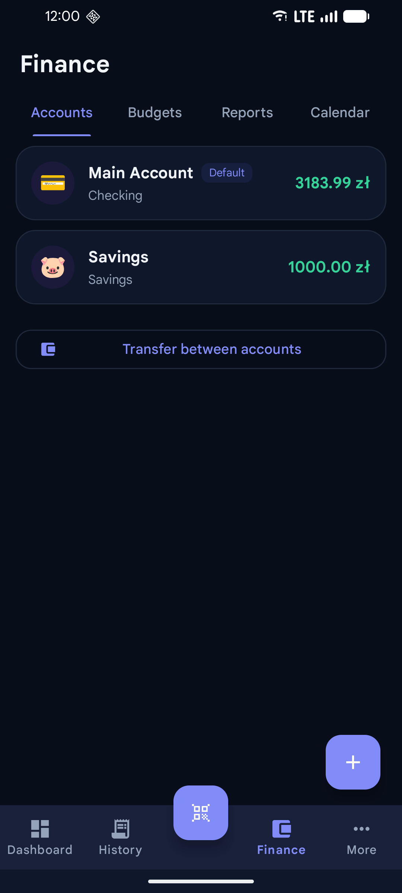
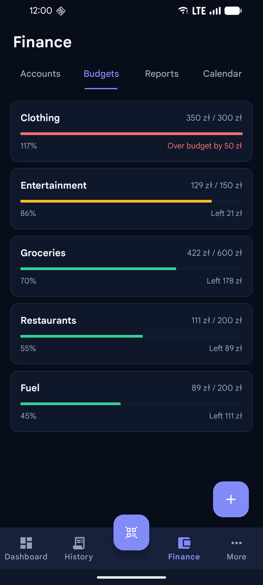
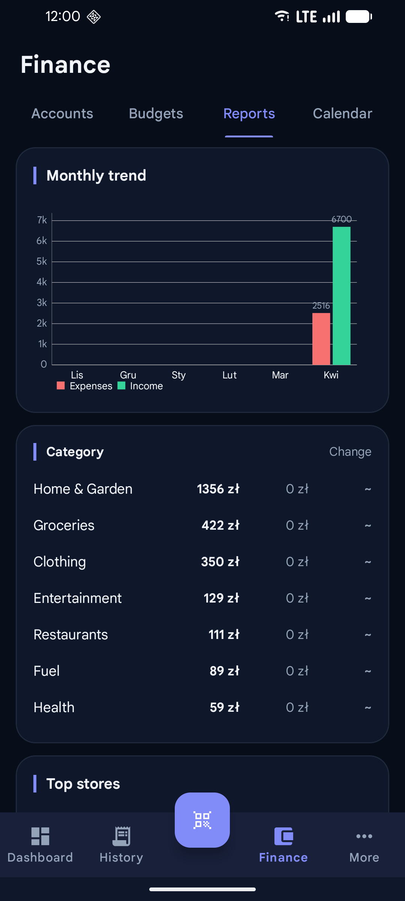
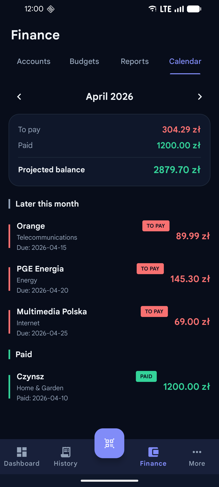

<div align="center">



# Skarbio

**Your private, 100% offline expense tracker for Android.**
Scan receipts and invoices with on-device OCR, track multiple accounts, set budgets, and see where your money goes — no cloud, no account, no tracking.

[](https://developer.android.com)
[](https://kotlinlang.org)
[-blue)](#requirements)
[](#license)

[Features](#features) · [Screenshots](#screenshots) · [Tech stack](#tech-stack) · [Getting started](#getting-started) · [Privacy](#privacy)

</div>

---

## Why Skarbio

Most budgeting apps want your bank login, your email, or a subscription. Skarbio doesn't. It runs entirely on your device: OCR, parsing, storage, backups — all local. There is no server, no account, and no network permission required for the app to function.

## Features

### 📸 Receipt scanning
- Capture with the camera or import from gallery / PDF
- Fully offline OCR (Google ML Kit Text Recognition) extracts store, amount and date
- Automatic categorization powered by a 500+ merchant keyword database
- Duplicate detection so you never log the same receipt twice

### 🧾 Invoice scanning
- Import PDF invoices from file or gallery
- Auto-extracts vendor, amount, due date and invoice number
- Installment forecasting for recurring bills (utilities, telecom) — pick which installments to save as future bills
- Warnings for stale invoices and missed due dates

### 💳 Multi-account
- Multiple accounts (checking / savings) with custom emoji and color
- Transfers between accounts
- Combined balance across all accounts on the dashboard

### 💰 Transactions
- Expenses, income and transfers in one unified list
- Grouped by date, filterable by category and month
- Search by merchant/source, edit and delete with undo

### 🧾 Bills
- Full CRUD for recurring bills: electricity, internet, rent, phone, etc.
- Status tracking: unpaid / paid / overdue
- Recurrence: monthly, quarterly, semi-annual, yearly
- Push reminders X days before the due date (WorkManager)

### 💹 Dashboard
- Monthly summary: income / expenses / net result
- Interactive pie chart — double-tap a slice to jump to that category's transactions
- Account balance switcher (net result / total balance / specific account)
- Budget alerts for categories approaching their limit

### 📊 Reports
- Bar chart of spending trends (last 6 months)
- Category comparison: current vs. previous month
- Top merchants by spend

### 📋 Budgets
- Monthly spending limit per category
- Progress bar with percentage used
- Alerts at 80% and 100% of budget

### 💾 Backup & restore
- Full database export to a single `.skb` file
- Optional AES-256-GCM encryption (PBKDF2, 100,000 iterations)
- Password-verified restore

### 📤 CSV import / export
- Export all transactions and bills to CSV (UTF-8 BOM — opens correctly in Excel)
- Import transactions back from a CSV file

### ⚙️ Settings
- Currency: PLN / EUR / USD
- Theme: light / dark / system
- Language: Polish / English / system (per-app locale, Android 13+)
- Biometric app lock

## Screenshots

<table>
  <tr>
    <td></td>
    <td></td>
    <td></td>
  </tr>
  <tr>
    <td align="center">Dashboard</td>
    <td align="center">History</td>
    <td align="center">Accounts</td>
  </tr>
  <tr>
    <td></td>
    <td></td>
    <td></td>
  </tr>
  <tr>
    <td align="center">Budgets</td>
    <td align="center">Reports</td>
    <td align="center">Calendar</td>
  </tr>
</table>

More screenshots and a project overview: **[skarbio landing page →](https://techparka.github.io/skarbio/)**

## Tech stack

| Layer | Technology |
|---|---|
| Language | Kotlin |
| UI | XML ViewBinding + Fragments |
| Architecture | MVVM + Kotlin Flow / StateFlow |
| DI | Hilt |
| Database | Room (6 tables) |
| OCR | ML Kit Text Recognition (on-device) |
| Document scanning | ML Kit Document Scanner |
| Charts | MPAndroidChart |
| Async | Kotlin Coroutines + Flow |
| Background work | WorkManager |
| Encryption | `javax.crypto` — AES-256-GCM, PBKDF2WithHmacSHA256 |
| PDF parsing | PdfBox-Android |

### Database schema

| Table | Purpose |
|---|---|
| `transactions` | Expenses, income, transfers |
| `bills` | Bills / invoices |
| `accounts` | User accounts |
| `categories` | System + custom categories |
| `budgets` | Monthly limits per category |
| `settings` | Key-value app settings |

### Project structure

```
app/src/main/java/com/budgetapp/ocr/
├── backup/              # BackupManager (AES-256-GCM)
├── data/
│   ├── local/           # Room database, DAOs, entities
│   ├── model/           # Shared enums/models
│   └── repository/      # Repositories
├── di/                  # Hilt modules
├── export/              # CSV import
├── service/             # Duplicate detection
├── ui/
│   ├── bills/           # Invoice scanning & bill management
│   ├── budget/          # Budgets
│   ├── dashboard/       # Dashboard
│   ├── finance/accounts/# Accounts & transfers
│   ├── reports/         # Accounts | Budgets | Reports tabs
│   ├── scan/            # Receipt scanning
│   ├── settings/        # Settings & categories
│   └── transactions/    # Transaction history
├── util/                # Helpers (image hashing, currency formatting, locale data)
├── BillReminderWorker.kt
├── CategoryManager.kt   # 500+ merchant keyword database
├── InvoiceParser.kt     # PDF invoice parsing
└── ReceiptTextRecognizer.kt
```

## Getting started

### Requirements

- Android Studio Hedgehog (2023.1.1) or newer
- JDK 17
- Android SDK, min API 24 (Android 7.0) / target API 35

### Build from source

```bash
git clone https://github.com/techparka/skarbio.git
cd skarbio
```

Open the project folder in Android Studio and let it sync Gradle, or build from the command line:

```bash
# Debug APK
./gradlew assembleDebug

# Unit tests
./gradlew test
```

The debug APK is written to `app/build/outputs/apk/debug/`. Install it on a connected device or emulator running API 24+:

```bash
adb install app/build/outputs/apk/debug/app-debug.apk
```

> Release builds require a signing configuration (`keystore.properties`) that is not included in this repository — see `app/build.gradle` for the expected format.

## Privacy

**All data stays on your device.** Skarbio does not require an internet connection to function, does not send data to any server, and does not collect analytics. OCR runs 100% offline via ML Kit.

The only network call in the app is an optional, unauthenticated lookup against Poland's public VAT registry (`wl-api.mf.gov.pl`) to resolve a company name from a NIP tax ID — no API key, no personal data sent beyond the NIP itself.

Full privacy policy: [`privacy-policy.html`](privacy-policy.html)

## License

This project is currently unlicensed / all rights reserved. Source is shared for portfolio and reference purposes.

---

<div align="center">

Built with [Claude Code](https://claude.ai/code)

</div>
