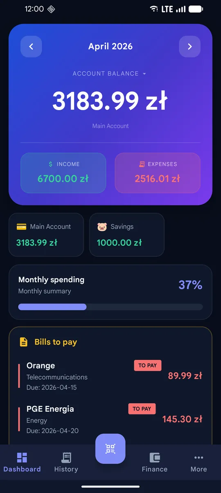
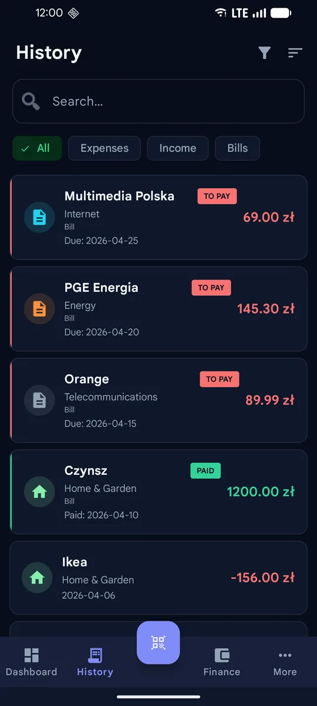
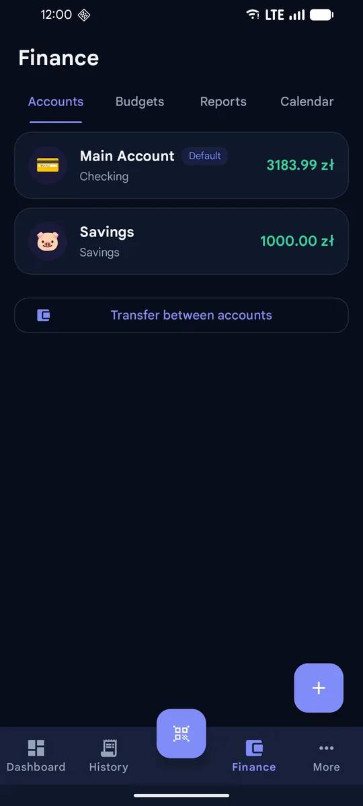
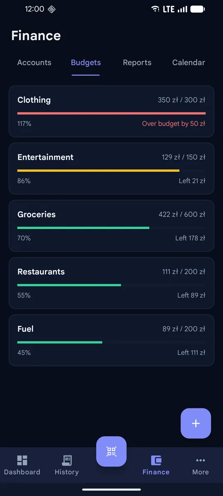
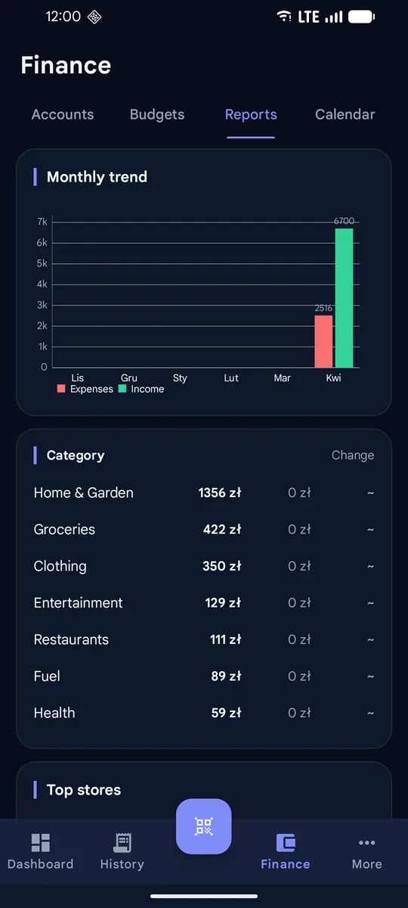
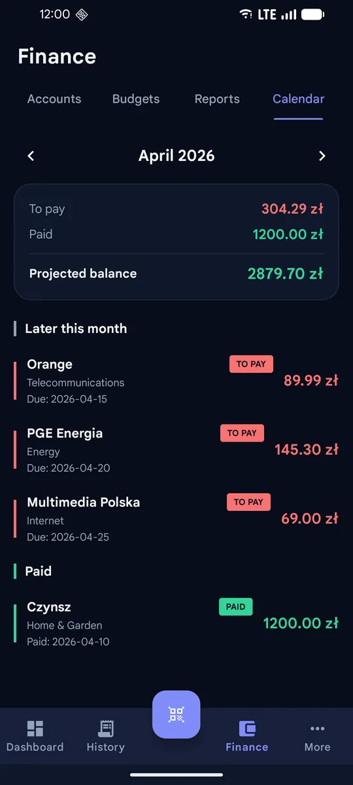

<div align="center">


# Skarbio

**A private expense tracker for Android with on-device receipt scanning.**

Scan a receipt, assign it to a category, and see how much of your monthly budget is left. Skarbio stores expenses, accounts, and bills locally and needs no sign-up.

[Try the interactive scan demo](https://techparka.github.io/skarbio/#demo) · [Build from source](#getting-started) · [Privacy policy](https://techparka.github.io/skarbio/privacy-policy.html)

</div>

Skarbio supports Android 7.0 and later (API 24). Build it from this repository to install it. There is currently no published APK or Google Play release.

## Features

- **Receipts and invoices.** Scan paper documents, import images, or open PDFs in Skarbio. Review extracted amounts and dates before saving. Receipt scanning warns about possible duplicates.
- **Categories and budgets.** Skarbio suggests categories using 220 Polish merchant keywords and fuzzy matching. Set monthly limits by category and see a dashboard alert starting at 80% of the limit.
- **Accounts and transactions.** Track expenses, income, and transfers across accounts. Browse transaction history and see monthly balances, spending trends, and top merchants.
- **Bills and reminders.** Track due dates and payment status, schedule recurring bills or installments, and enable reminders before bills are due.
- **Import, export, and backups.** Import transactions from CSV, export transactions and bills to CSV, or back up the database in a `.skb` file with optional password-based encryption.
- **Personalization.** Use PLN, EUR, or USD, switch between Polish and English, choose a light or dark theme, and enable app lock.

## Screenshots

<table>
  <tr>
    <td align="center"><br />Dashboard</td>
    <td align="center"><br />History</td>
    <td align="center"><br />Accounts</td>
  </tr>
  <tr>
    <td align="center"><br />Budgets</td>
    <td align="center"><br />Reports</td>
    <td align="center"><br />Calendar</td>
  </tr>
</table>

[Open the full-size gallery](https://techparka.github.io/skarbio/#screens)

## Getting started

### Requirements

- Android Studio with Gradle set to use JDK 17
- Android SDK Platform 35
- A device or emulator running Android 7.0 (API 24) or later. Use a device or emulator with Google Play services for ML Kit scanning.

### Build and run

```bash
git clone https://github.com/techparka/skarbio.git
cd skarbio
```

Open the project in Android Studio, let Gradle sync, select a device or emulator, and choose **Run**. This also works on Windows.

From a Bash shell with the Android SDK configured, you can build and install a debug APK as follows.

```bash
bash ./gradlew assembleDebug
adb install app/build/outputs/apk/debug/app-debug.apk
```

A signed release build requires a local `keystore.properties` file. The expected fields are listed in [app/build.gradle](app/build.gradle).

## Privacy

Skarbio stores transactions, bills, and account data in a local Room database. The app has no sign-up, cloud sync, ads, or analytics. Receipt text recognition runs on the device. Google Play services may need to download the OCR model and document scanner components before the first scan. See the ML Kit guides for [text recognition](https://developers.google.com/ml-kit/vision/text-recognition/v2/android) and the [document scanner](https://developers.google.com/ml-kit/vision/doc-scanner/android).

The optional store-name lookup sends the receipt's tax ID (NIP) to Poland's public VAT registry. The setting is off by default. See the [full privacy policy](https://techparka.github.io/skarbio/privacy-policy.html).

## Tech stack

| Area | Implementation |
| --- | --- |
| Android UI | Kotlin, XML layouts, ViewBinding, Fragments |
| Architecture | MVVM, Coroutines, Flow, Hilt |
| Local storage | Room / SQLite with seven tables |
| Document processing | ML Kit Text Recognition, ML Kit Document Scanner, CameraX, PdfBox-Android |
| Charts and reminders | MPAndroidChart, WorkManager |
| Password-protected backups | AES-256-GCM, PBKDF2-HMAC-SHA256 with 100,000 iterations |

The Room schema is defined in [AppDatabase.kt](app/src/main/java/com/budgetapp/ocr/data/local/AppDatabase.kt), and the backup format is implemented in [BackupManager.kt](app/src/main/java/com/budgetapp/ocr/backup/BackupManager.kt).

## License

The source is publicly viewable. All rights reserved.
